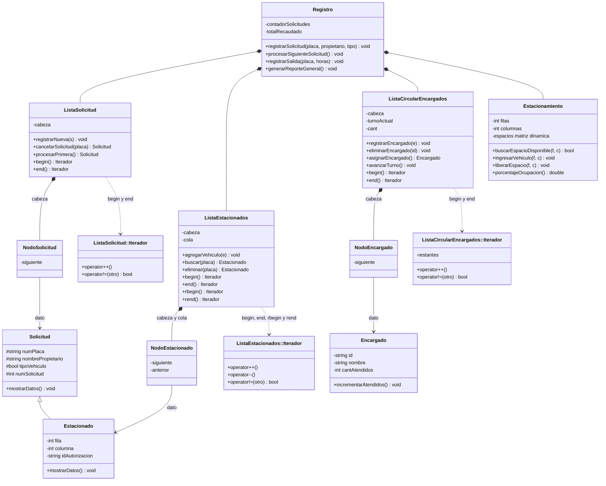

# 2da_programada}

cricia no iso nada

# Sistema de Administración de Estacionamiento Inteligente

**Proyecto II · Programación II** · C++17 · aplicación de consola

**Integrantes:** Krissia Santamaría Rodriguez (C5J775) y Julian Barrantes Madrigal (C5D034)

El sistema controla el ingreso y la salida de vehículos de un estacionamiento mediante cuatro estructuras dinámicas que colaboran: una lista simple de solicitudes en espera, una lista doble de vehículos estacionados, una lista circular de encargados y una matriz dinámica de espacios. La clase `Registro` las coordina y es la única con la que habla el menú interactivo.

Cuando se procesa una solicitud, el sistema primero valida que existan solicitudes, un espacio libre y al menos un encargado. Solo entonces retira la solicitud de la lista simple, toma al encargado en turno, marca el espacio en la matriz, agrega el vehículo al final de la lista doble y suma una atención al encargado.

Restricciones del enunciado respetadas: no se usan `std::list`, `std::forward_list`, `std::queue`, `std::deque` ni `std::vector`; solo se incluyen `<iostream>`, `<string>`, `<stdexcept>` e `<iomanip>`; los datos viven solo en memoria durante la ejecución.

## Compilar y ejecutar

El proyecto se compila con un solo comando de g++ y se ejecuta desde la consola, sin dependencias externas. El repositorio incluye además un `estacionamiento.exe` compilado para Windows.

1. Descomprima o clone el proyecto y abra una terminal en la carpeta `2da_programada`.
2. Compile todos los archivos fuente:

   ```bash
   g++ -Wall -Wextra -std=c++17 *.cpp -o estacionamiento.exe
   ```

3. Ejecute el programa (en Windows PowerShell: `.\estacionamiento.exe`):

   ```bash
   ./estacionamiento.exe
   ```

Al iniciar, el programa corre las 14 pruebas automatizadas y muestra «Todas las 14 pruebas automatizadas finalizaron exitosamente!». Después pide la cantidad de filas y columnas del estacionamiento y abre el menú principal. Las placas y los nombres se leen como línea completa, por lo que pueden llevar espacios; el tipo de vehículo se elige con 1 (automóvil) o 2 (motocicleta).

| Opción | Función | Submenú |
| --- | --- | --- |
| 1 | Gestionar solicitudes de ingreso: registrar, mostrar pendientes, consultar por placa y cancelar | Sí |
| 2 | Procesar la siguiente solicitud (ingreso del vehículo) | No |
| 3 | Consultar vehículos estacionados: orden directo, orden inverso, buscar por placa y total | Sí |
| 4 | Registrar la salida de un vehículo: pide placa y horas y muestra el comprobante | No |
| 5 | Gestionar encargados: registrar, eliminar, ver el siguiente en turno, listar y mostrar el orden de rotación | Sí |
| 6 | Mostrar la matriz del estacionamiento con su ocupación | No |
| 7 | Generar el reporte general | No |
| 0 | Salir y liberar la memoria | No |


## Organización de las clases

El proyecto define 11 clases, más 3 iteradores anidados dentro de las listas, repartidas en 23 archivos (`.hpp` y `.cpp`). Cada clase cubre uno de los componentes que pide la sección 8.1 del enunciado.



Un rombo relleno (`*--`) indica que la clase de la izquierda crea y libera a la de la derecha; `<|--` indica herencia y la flecha punteada (`..>`) indica que la lista entrega ese iterador, que está definido como clase anidada dentro de ella. Los métodos y atributos mostrados son los principales, no la lista completa.

| Clase | Responsabilidad | Componente del enunciado |
| --- | --- | --- |
| `Solicitud` | Guarda placa, propietario, tipo (`true` = automóvil) y número de solicitud. Rechaza placa o nombre vacíos. | Solicitud de ingreso |
| `Estacionado` | Hereda de `Solicitud` y agrega fila, columna e ID del encargado que autorizó el ingreso. | Vehículo estacionado |
| `Encargado` | Guarda ID, nombre y cantidad de vehículos atendidos. | Encargado |
| `NodoSolicitud`, `NodoEstacionado`, `NodoEncargado` | Nodos propios: dato y enlace al siguiente; el de `NodoEstacionado` suma el enlace al anterior. | Nodos de cada lista |
| `ListaSolicitud` | Lista simple con cabeza. Registra al final, muestra, consulta, cancela en cualquier posición, procesa la primera y cuenta. | Lista enlazada simple |
| `ListaEstacionados` | Lista doble con cabeza y cola. Agrega, recorre en ambos sentidos, busca, elimina (inicio, medio o final) y cuenta, también por tipo. | Lista doblemente enlazada |
| `ListaCircularEncargados` | Lista circular con el turno actual. Registra, elimina, consulta y asigna al encargado en turno, y avanza el turno. | Lista enlazada circular |
| `Estacionamiento` | Matriz `int**` reservada con `new[]` y liberada con `delete[]` (0 libre, 1 ocupado). Busca el primer espacio libre, ocupa, libera y calcula ocupación. | Matriz dinámica |
| `Registro` | Compone las cuatro estructuras, lleva el contador de solicitudes y el total recaudado, e implementa ingreso, salida y reportes. | Sistema de administración |

Además, `main.cpp` contiene el menú principal y los tres submenús (solicitudes, estacionados y encargados), la lectura validada de enteros y las 14 pruebas automatizadas.

## Decisiones de diseño

Cada decisión busca que una operación fallida no deje las estructuras en un estado inconsistente.

- **Herencia entre `Solicitud` y `Estacionado`.** Un vehículo estacionado es una solicitud aprobada, así que reutiliza placa, propietario, tipo y número de solicitud. `mostrarDatos()` es virtual, se redefine con `override` y el destructor de la base es virtual.
- **Propiedad de la memoria.** Las listas guardan punteros a objetos creados con `new`. `ListaSolicitud` y `ListaEstacionados` liberan datos y nodos en su destructor; `NodoEncargado` libera su `Encargado`. Cuando una operación saca un elemento (`cancelarSolicitud`, `procesarPrimera`, `eliminar`), libera el nodo y devuelve el puntero del dato; `Registro` lo usa y luego lo libera con `delete`.
- **Sin copias superficiales.** `ListaSolicitud`, `ListaEstacionados`, `ListaCircularEncargados`, `Estacionamiento` y `Registro` tienen el constructor de copia y `operator=` marcados con `= delete`.
- **Validar antes de modificar.** `procesarSiguienteSolicitud` comprueba que haya solicitudes, un espacio libre y un encargado antes de tocar ninguna estructura; si falla, la solicitud sigue en espera y el turno no avanza. `registrarSalida` valida las horas y busca el vehículo antes de eliminarlo.
- **Reversión local.** `registrarSolicitud` devuelve el contador a su valor anterior si la inserción falla, y `registrarEncargado` libera el `Encargado` recién creado si la lista lo rechaza; ambos usan `try`/`catch` y vuelven a lanzar con `throw;`.
- **Numeración de solicitudes.** El contador vive en `Registro` y solo sube cuando el registro tiene éxito. Cancelar una solicitud no reutiliza su número: en la ejecución de prueba, tras cancelar S003, la siguiente fue S005.
- **Placas únicas.** `Registro` revisa la placa en la lista de espera y en la de estacionados, y cada lista valida además la suya.
- **Historial de encargados.** `Estacionado` guarda el ID del encargado como texto, no un puntero. Por eso eliminar un encargado no invalida los ingresos que ya atendió; si tenía el turno, este pasa al siguiente de la lista circular.
- **Tipo de vehículo y tarifas.** El tipo es un `bool` (`true` = automóvil) y las tarifas (₡900 y ₡500 por hora) son constantes dentro de `Registro::registrarSalida`, tal como las fija el enunciado.
- **Pruebas en el mismo ejecutable.** `main()` corre las pruebas automatizadas al iniciar. Si alguna falla, el programa termina con código 1 y no abre el menú.

## Iteradores y excepciones

Las tres listas se recorren con iteradores propios, definidos como clases anidadas `Iterador`, y los errores se reportan con excepciones de `<stdexcept>`. Ni `main()` ni `Registro` manipulan nodos: `Registro` llama a métodos de las listas y las pruebas de `main()` recorren con `begin()`, `end()` y `rbegin()`.

### Iteradores

| Iterador | Operaciones | Cuándo termina | Se usa en |
| --- | --- | --- | --- |
| `ListaSolicitud::Iterador` | `operator*`, `operator++`, `operator!=`; `begin()`, `end()` | Al llegar a `nullptr` | `mostrarPendientes`, `existePlaca`, `consultarPendientes` |
| `ListaEstacionados::Iterador` | Las anteriores más `operator--`; `rbegin()` y `rend()` | Al llegar a `nullptr` en cualquiera de los dos extremos | `recorrerPrimero` (adelante), `recorrerUltimo` (atrás), `existePlaca`, `totalEstacionados`, `contarAutomoviles`, `contarMotocicletas` |
| `ListaCircularEncargados::Iterador` | `operator*`, `operator++`, `operator!=`; `begin()`, `end()` | Tras exactamente una vuelta, porque lleva un contador de elementos restantes | `mostrarEncargados`, `mostrarOrdenRotacion`, `existeID` |

En los tres, `operator*` devuelve una referencia al dato (`Solicitud&`, `Estacionado&` o `Encargado&`) y lanza `out_of_range` si el iterador ya está al final; avanzar o retroceder desde el final no hace nada. Con una lista vacía, `begin()` es igual a `end()` y el recorrido no ejecuta ninguna vuelta. El iterador circular evita el ciclo infinito porque `restantes` baja en cada `++` y, al llegar a 0, el iterador pasa a `nullptr`.

### Excepciones

| Excepción | Situación en que se lanza | Dónde |
| --- | --- | --- |
| `invalid_argument` | Placa, propietario, ID o nombre vacíos; dimensiones ≤ 0; horas ≤ 0; tipo de vehículo distinto de 1 o 2; punteros nulos | `Solicitud`, `Encargado`, `Estacionamiento`, `Registro::registrarSalida`, listas, `main` |
| `out_of_range` | Solicitud, vehículo o encargado inexistente; fila o columna fuera de la matriz; desreferenciar un iterador al final | `ListaSolicitud`, `ListaEstacionados`, `ListaCircularEncargados`, `Estacionamiento`, iteradores |
| `overflow_error` | No quedan espacios al procesar una solicitud | `Registro::procesarSiguienteSolicitud` |
| `underflow_error` | Procesar o cancelar con la lista de espera vacía; eliminar de una lista doble o circular vacía | `Registro`, `ListaSolicitud`, `ListaEstacionados`, `ListaCircularEncargados` |
| `logic_error` | Placa o ID de encargado duplicados; no hay encargados; ocupar un espacio ocupado o liberar uno libre | `Registro`, las tres listas, `Estacionamiento` |

El menú principal, cada submenú y la configuración inicial capturan `std::exception&`, muestran `Error: <mensaje>` y siguen funcionando, sin `exit()`. Las pruebas automatizadas capturan cada tipo concreto para comprobar que se lanza el correcto.

## Pruebas y resultados

Las 14 pruebas automatizadas del enunciado pasan, el escenario completo de la sección 7 se reproduce desde el menú y la ejecución no pierde memoria. Los resultados se obtuvieron compilando con g++ 13.3.0 en Linux, con `-Wall -Wextra -std=c++17`: sin errores y con una sola advertencia.

### Pruebas automatizadas

`ejecutarPruebasAutomatizadas()` corre al iniciar el programa y usa `verificarPrueba()` (lanza `runtime_error` si una condición falla). Son 14 casos con 20 verificaciones; la salida termina con «Todas las 14 pruebas automatizadas finalizaron exitosamente!».

| N.º | Caso | Qué se verifica | Resultado |
| --- | --- | --- | --- |
| 1 | Registrar una solicitud válida | Tres solicitudes registradas: `consultarPendientes() == 3` | Pasa |
| 2 | Cancelar la primera | Tras cancelar `AAA111`, `BBB222` sigue siendo la solicitud número 2 | Pasa |
| 3 | Cancelar una intermedia | Se cancela `CCC333` y quedan 2 pendientes | Pasa |
| 4 | Eliminar un vehículo de la lista doble | Se elimina `EST002` (nodo intermedio) y el total baja a 2 | Pasa |
| 5 | Recorrer la lista doble en ambos sentidos | `begin()` con `++` da `EST001`, `EST002`; `rbegin()` con `--` da `EST003`, `EST002` | Pasa |
| 6 | Asignar cuatro vehículos con tres encargados | El orden es Ana, Luis, Maria, Ana | Pasa |
| 7 | Eliminar un encargado de la lista circular | Quedan 2 encargados y el turno ya no está en Luis | Pasa |
| 8 | Ocupar todos los espacios | En una matriz de 1×2 hay 2 vehículos estacionados | Pasa |
| 9 | Ingresar con el estacionamiento lleno | Se lanza `overflow_error` y la solicitud sigue pendiente | Pasa |
| 10 | Registrar horas negativas | Se lanza `invalid_argument` con −3 horas | Pasa |
| 11 | Registrar una placa duplicada | Se lanza `logic_error` | Pasa |
| 12 | Retirar un vehículo | Queda 1 estacionado y se recaudan ₡2700 (3 h × ₡900) | Pasa |
| 13 | Procesar una lista de espera vacía | Se lanza `underflow_error` | Pasa |
| 14 | Consultar una lista vacía con iteradores | El recorrido da 0 vueltas y no desreferencia nada | Pasa |

### Pruebas de integración desde el menú

Se reprodujo la secuencia de la sección 7 del enunciado (matriz de 2×2, tres encargados y las solicitudes S001 a S007) alimentando el menú con las mismas opciones que usaría una persona. Los valores coinciden con los del enunciado: espacios asignados, orden de los encargados, montos y porcentajes. Los textos de los mensajes difieren, lo que el enunciado permite.

| Enunciado | Qué se hizo | Resultado observado |
| --- | --- | --- |
| 7.1 | Crear 2×2 y registrar E01 Ana, E02 Luis y E03 Maria | «Espacios disponibles: 4»; rotación Ana -> Luis -> Maria -> Ana; próximo: Ana |
| 7.2 | Registrar cuatro solicitudes, consultar `MOTO45`, repetir `ABC123` y cancelar `XYZ789` | Duplicada rechazada (`logic_error`); se cancela la S003, que estaba en medio; quedan S001, S002 y S004 (3 pendientes) |
| 7.3 | Procesar dos solicitudes y recorrer la lista doble | `ABC123` en (1,1) con Ana y `MOTO45` en (1,2) con Luis; el recorrido inverso muestra los mismos vehículos al revés |
| 7.4 | Registrar `NEW777` y procesar dos solicitudes más | `JKL555` en (2,1) con Maria y `NEW777` en (2,2) con Ana; 4 espacios ocupados, 100.00 % |
| 7.5 | Registrar `ESP888` con el estacionamiento lleno y procesar | `overflow_error`; la solicitud sigue en espera y el próximo encargado sigue siendo Luis |
| 7.6 | Salida de `ABC123` con −3 horas y luego con 3 | Con −3 se rechaza y `ABC123` sigue en (1,1); con 3 se cobran ₡2700, se libera (1,1) y la ocupación baja a 75.00 % |
| 7.7 | Procesar `ESP888` | Ocupa (1,1) con Luis y queda al final de la lista doble; vuelven a ser 4 estacionados |
| 7.8 | Reporte general, repetir `MOTO45` y salida de `NOEXISTE` | 2 automóviles y 2 motocicletas, ₡2700 recaudados; atendidos: Ana 2, Luis 2, Maria 1; placa duplicada rechazada (`logic_error`) e inexistente rechazada (`out_of_range`) |
| 7.9 | Eliminar E02, registrar y cancelar `TEMP100`, procesar sin solicitudes y salir | Rotación Ana -> Maria -> Ana con próximo Maria; `underflow_error` al procesar sin solicitudes; «Memoria liberada. Programa finalizado.» |

### Casos de borde adicionales

Una segunda ejecución guiada cubrió situaciones que el enunciado pide controlar:

- Dimensiones 0 y −1 se rechazan y se vuelven a pedir; una entrada no numérica («abc») no cierra el programa.
- Procesar sin solicitudes, y procesar sin encargados: en este caso la solicitud S001 sigue en espera.
- Tipo de vehículo 3 rechazado en el submenú de solicitudes.
- Eliminar con la lista de encargados vacía (`underflow_error`), repetir un ID (`logic_error`) y eliminar un ID inexistente (`out_of_range`).
- Eliminar al único encargado deja la lista vacía; después se registra otro y el ingreso funciona con él.
- Horas igual a 0 se rechazan; una salida válida de 1 hora cobra ₡900.
- Con la lista doble vacía, los dos recorridos muestran «No hay vehiculos estacionados.» y el total es 0.

## Limitaciones y mejoras posibles

Ninguna de estas limitaciones afecta los resultados de la sección anterior; son puntos que conviene conocer o pulir.

- **Propiedad de los nodos poco uniforme.** `NodoEncargado` libera su `Encargado`, mientras que las listas simple y doble liberan los datos desde sus destructores. Funciona porque los nodos nunca se copian.
- **Tipo y tarifas fijos.** Un `enum class` para el tipo de vehículo y una tabla de tarifas facilitarían agregar nuevos tipos sin tocar `Registro::registrarSalida`.
- **Pruebas dentro del programa.** Correr las pruebas en cada inicio, en el mismo ejecutable, mezcla sus mensajes con los del programa. Un archivo de pruebas aparte o una opción de compilación las separaría.